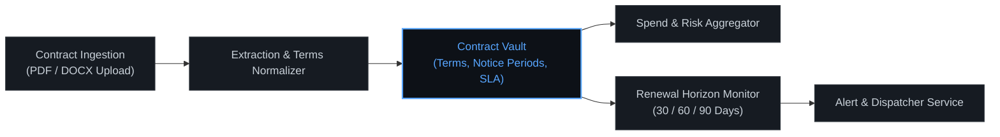

# ContractPulse

<p align="left">
  
  
  
</p>

**ContractPulse** is an AI-powered contract management dashboard that helps teams track vendor contracts, renewal deadlines, and auto-renewal risks — all in one place.

---

### Architecture & Pipeline Flow



---

## Features

- 📋 **Contract Dashboard** — At-a-glance view of all contracts, spend, and urgency
- 🔔 **Smart Alerts** — Automated 30/60/90-day renewal warnings
- 📁 **Contract Upload** — Upload and parse PDF/DOCX contracts
- 🔍 **Contract Detail View** — Full breakdown of terms, notice periods, and deadlines
- ⚙️ **Settings** — Manage notification preferences and account info
- 🔐 **Authentication** — Secure login/signup flow

---

## Tech Stack

| Layer     | Technology                            |
|-----------|---------------------------------------|
| Frontend  | React 18 + Vite                       |
| Styling   | Tailwind CSS                          |
| Routing   | React Router v6                       |
| Icons     | Lucide React                          |
| Build     | Vite                                  |

---

## Getting Started

### Prerequisites

- Node.js 18+
- npm or yarn

### Installation

```bash
# Clone the repository
git clone git@github.com:parth2024-tech/contractpulse.git
cd contractpulse

# Install dependencies
npm install

# Start the development server
npm run dev
```

The app will be available at `http://localhost:5173`.

---

## Project Structure

```
src/
├── components/         # Reusable UI components
│   ├── DashboardLayout.jsx
│   ├── Sidebar.jsx
│   └── Toast.jsx
├── pages/              # Route-level page components
│   ├── Landing.jsx
│   ├── Auth.jsx
│   ├── Dashboard.jsx
│   ├── Contracts.jsx
│   ├── ContractDetail.jsx
│   ├── Upload.jsx
│   ├── Alerts.jsx
│   └── Settings.jsx
├── data.js             # Mock contract data and utility functions
├── App.jsx             # Root component and routing
├── main.jsx            # App entry point
└── index.css           # Global styles
```

---

## Contributing

Pull requests are welcome! Please open an issue first to discuss any major changes.

---

## License

MIT © parth2024-tech
